# ER diagramma (FitHayot 360)

```mermaid
erDiagram
    users ||--|| fitness_profiles : has
    users ||--|| user_settings : has
    users ||--o{ consent_events : gives
    users ||--o{ workout_plans : owns
    users ||--o{ workout_sessions : performs
    users ||--o{ activity_logs : records
    users ||--o{ content_audit : "admin edits"
    workout_plans ||--o{ plan_items : contains
    workout_plans |o--o{ workout_sessions : "optional link"
    exercise_categories ||--o{ exercises : groups
    exercises ||--o{ plan_items : planned_as
    exercises ||--o{ exercise_logs : performed_as
    exercises ||--o{ content_audit : audited
    plan_items |o--o{ exercise_logs : fulfilled_by
    workout_sessions ||--o{ exercise_logs : has
    activity_types ||--o{ activity_logs : typed
    users ||--|| user_goals : sets
    users ||--o{ water_logs : drinks
    users ||--o{ sleep_logs : sleeps
    users ||--o{ step_logs : walks
    users ||--o{ meal_logs : eats
    users ||--o{ meditation_logs : meditates
    users ||--o| premium_interest : waits
    users ||--o{ habits : tracks
    habits ||--o{ habit_checks : checked
    programs ||--o{ program_items : contains
    exercises ||--o{ program_items : used_in
    recipes |o--o{ meal_logs : from
    meditation_items |o--o{ meditation_logs : from

    users { int id PK  string email UK  string password_hash  string role  bool is_adult_confirmed  datetime created_at }
    fitness_profiles { int user_id FK  string goal  string experience_level  string preferred_location  int daily_minutes }
    user_settings { int user_id FK  string language_code  bool reminders_enabled  string privacy_version }
    consent_events { int user_id FK  string policy_version  string purpose  datetime accepted_at  datetime revoked_at }
    exercise_categories { int id PK  string code UK  string name  string mode "home|gym" }
    exercises { int id PK  int category_id FK  string title  text description  string equipment  string difficulty  text safety_note  bool is_active }
    workout_plans { int id PK  int user_id FK  string title  date starts_on  date ends_on  string status }
    plan_items { int id PK  int plan_id FK  int exercise_id FK  date planned_date  int planned_minutes  int sort_order }
    workout_sessions { int id PK  int user_id FK  int plan_id FK  datetime started_at  datetime finished_at  string status  string mode  text notes }
    exercise_logs { int id PK  int session_id FK  int exercise_id FK  int plan_item_id FK  int set_no  int reps  float weight_kg  int duration_seconds  string idempotency_key }
    activity_types { int id PK  string code UK  string title }
    activity_logs { int id PK  int user_id FK  int activity_type_id FK  datetime occurred_at  int duration_minutes  float distance_km  string note  string idempotency_key }
    content_audit { int id PK  int admin_user_id FK  int exercise_id FK  string action  datetime occurred_at }
    user_goals { int user_id FK  int steps_goal  int water_goal_ml  int sleep_goal_min  int workout_goal_min  int calorie_goal }
    water_logs { int user_id FK  int amount_ml  datetime logged_at  string idempotency_key }
    sleep_logs { int user_id FK  date sleep_date  int duration_min  int quality }
    step_logs { int user_id FK  date day  int steps }
    recipes { int id PK  string title  string meal_type  int kcal  int prep_minutes  text ingredients  text instructions }
    meal_logs { int user_id FK  int recipe_id FK  string title  string meal_type  int kcal  datetime eaten_at }
    meditation_items { int id PK  string title  string category  int duration_min  text guide }
    meditation_logs { int user_id FK  int item_id FK  int duration_min  datetime completed_at }
    programs { int id PK  string title  string mode  string kind  string difficulty  int duration_min  string image_url }
    program_items { int program_id FK  int exercise_id FK  int seconds  int reps  int sort_order }
    habits { int id PK  int user_id FK  string title }
    habit_checks { int habit_id FK  date day }
    premium_interest { int user_id FK  datetime created_at }
```

TT'dagi jadvallarga qo'shimchalar: `workout_sessions.notes`, `exercise_logs.plan_item_id`
(reja bandi bajarilganini aniq aniqlash), `exercise_logs.idempotency_key` va `activity_logs.idempotency_key` (AT-10).
To'liq DDL: [schema.sql](schema.sql).
